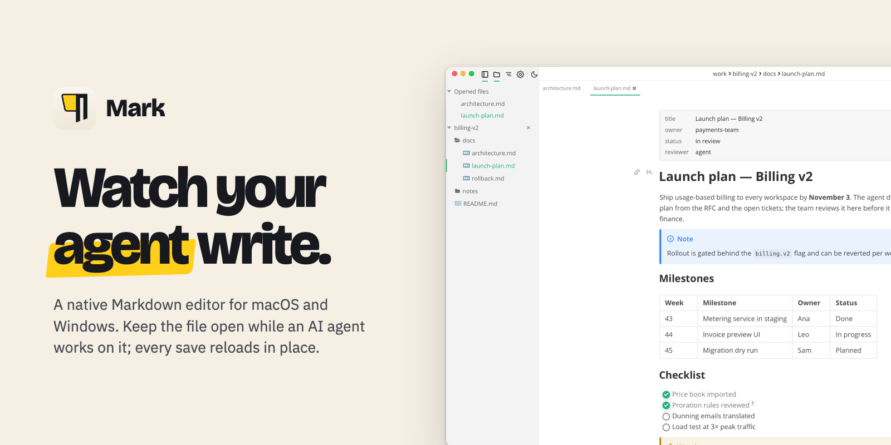
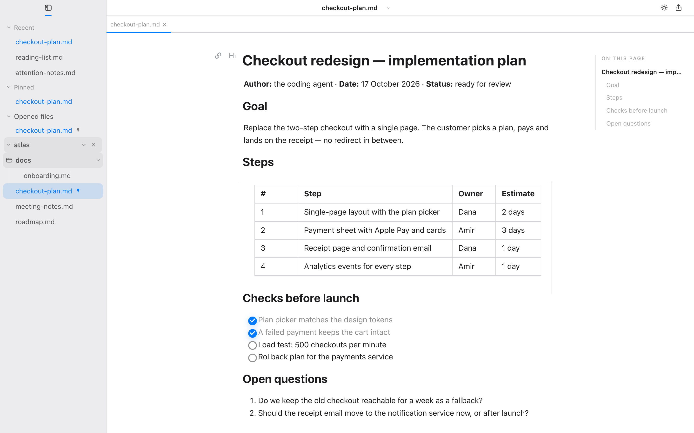
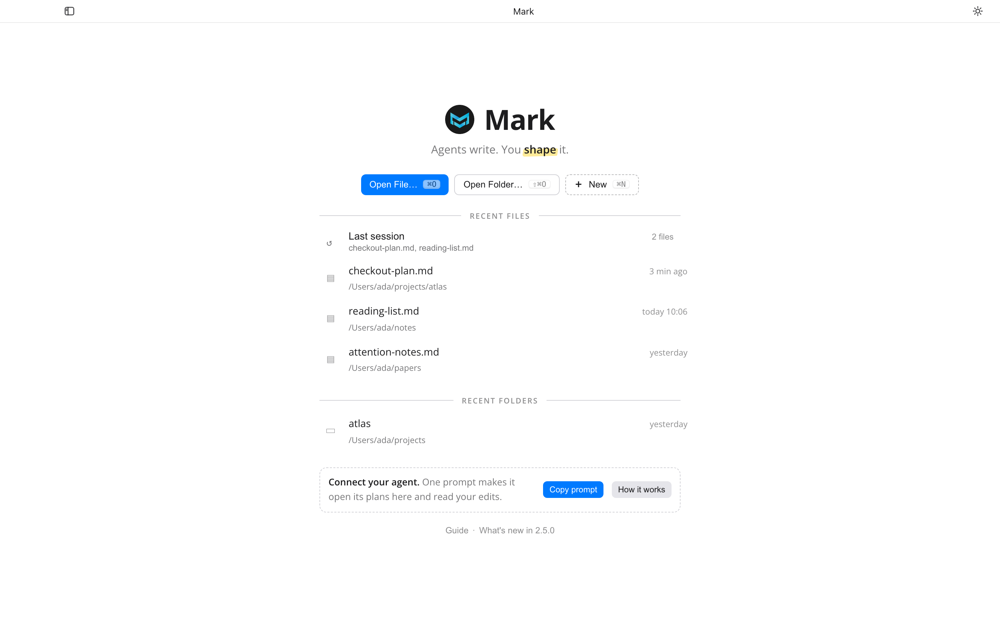
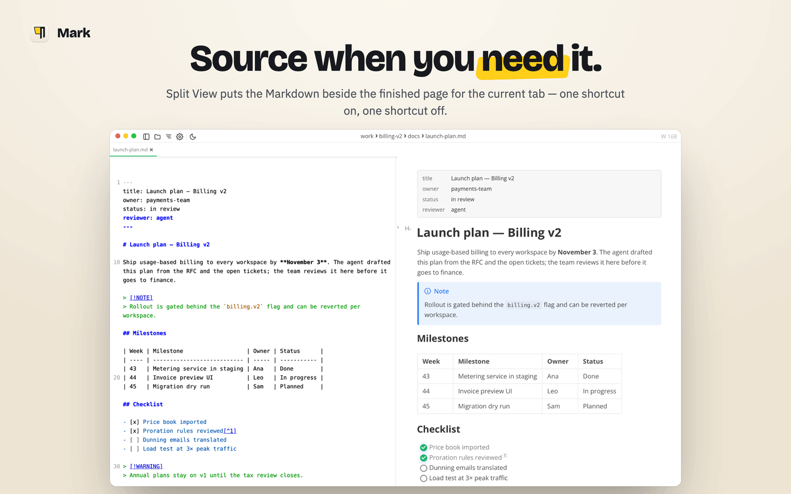
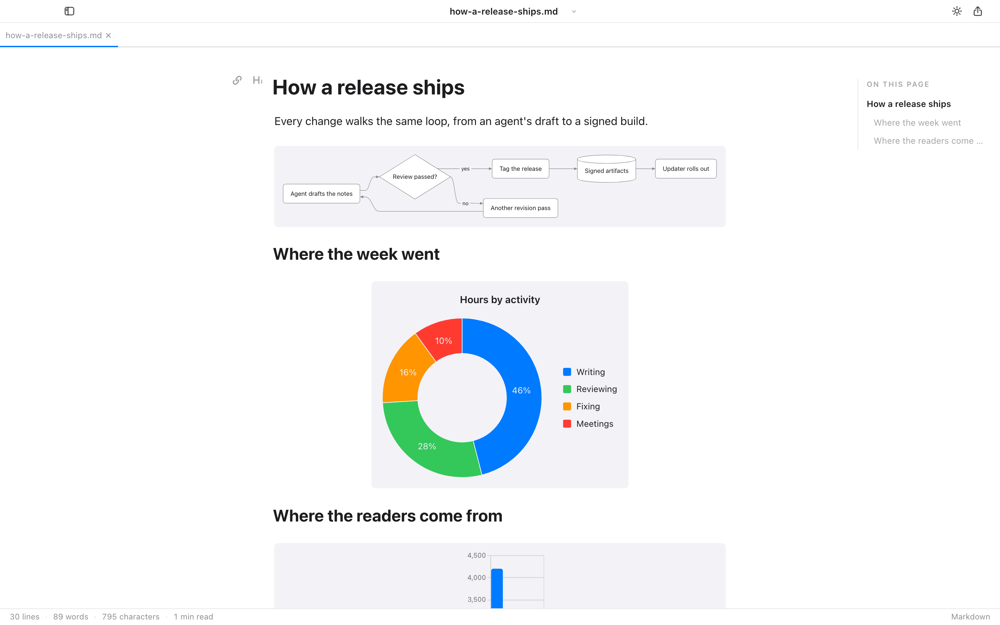
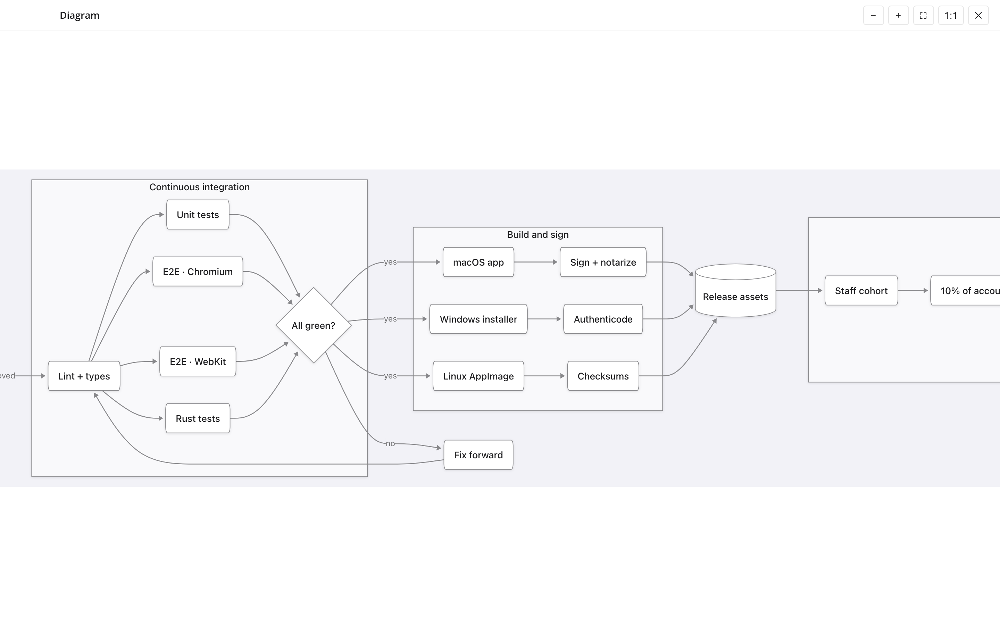
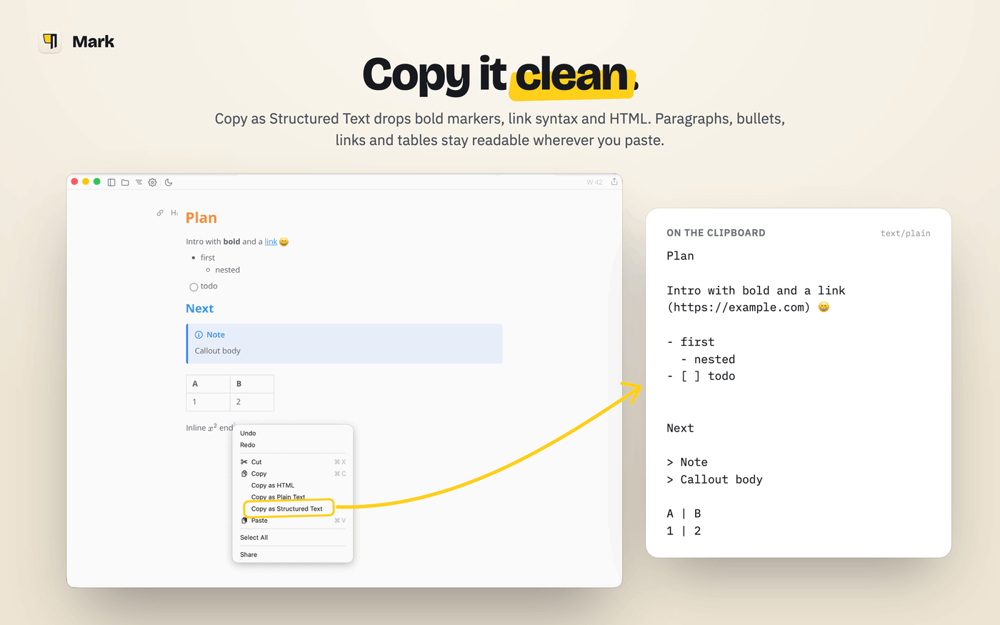
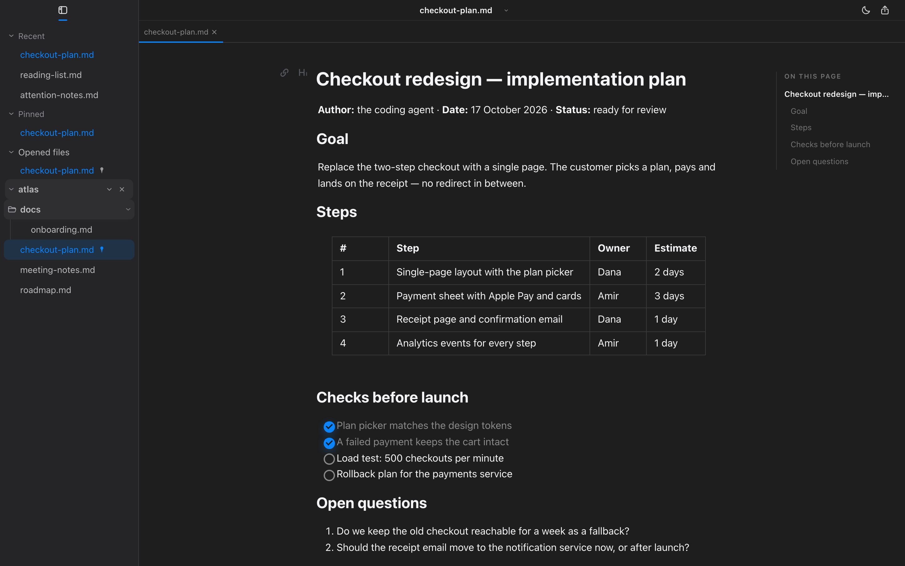

<div align="center">

<picture>
  <source media="(prefers-color-scheme: dark)" srcset="docs/assets/readme/cover-dark.png">
  
</picture>

<br><br>

**Mark is a WYSIWYG Markdown editor for reading and editing the files your AI agents write, while they write them.**

<br>

[](https://github.com/xronocode/mark/releases/latest)
&ensp;[](https://github.com/xronocode/mark/actions/workflows/test.yml)
&ensp;[](LICENSE)
&ensp;

</div>

## Install

**Mac App Store**

[Get Mark on the Mac App Store](https://apps.apple.com/app/id6814590464). Installs and updates through the App Store.

**Homebrew (macOS, Apple silicon)**

```sh
brew install --cask xronocode/mark/mark
```

Developer ID signed and notarized by Apple. Updates through the in-app updater or `brew upgrade --cask mark`.

**Windows (x64)**

Download `Mark_<version>_x64-setup.exe` from [the latest release](https://github.com/xronocode/mark/releases/latest). The installer is not code-signed yet, so SmartScreen shows "Windows protected your PC": choose *More info*, then *Run anyway*.

The App Store build and the Homebrew/download build are the same editor with a few differences. See [Two editions, same editor](#two-editions-same-editor).

## What's new in 2.6.1

- **Sessions come back honestly.** Launching Mark restores your tabs, folders and the active tab. Turn that off, and the welcome screen's "Last session (2)" row reopens exactly what was there at launch — never a stale no-op.
- **Closed a tab by accident?** A count-badged button beside the tab strip lists recently closed tabs. ⇧⌘T brings the newest one back; repeated presses walk further back; "Reopen all" restores a whole batch in order.
- **HTML exports travel on their own.** Export as HTML now embeds local images into the file, so one .html opens anywhere without its picture folder. Remote images are never fetched.
- **⇧⌘P is back** — the command palette shortcut returns on macOS. Table exports keep every real cell, and turning Auto Save off stops pending saves immediately.
- **Windows gets its real title bar.** Native system caption buttons, the app-menu and settings buttons kept, the theme toggle docked as a fourth cell — no more alien controls.

The 2.6.0 highlights — tables as pictures, stable wide-table controls, ⌘D compare — are in [CHANGELOG.md](CHANGELOG.md).

## What's new in 2.6.0

- **Tables travel as pictures.** Copy a table as an image, or save a PNG from the fullscreen table viewer — useful for reviews, chats and presentations where Markdown tables fall apart.
- **Wide tables stay under control.** Full width and Fit to page keep their state through editor updates. The fullscreen viewer uses one clear navigation model — drag to pan — with edge shadows showing where more columns remain.
- **Compare with what Mark opened.** ⌘D compares a note with the version that was present when Mark opened it, even outside a Git repository; an unchanged note gets a calm, explicit result.
- **Editing shortcuts work again.** ⇧⌘D duplicates the current paragraph, while ⌘1–6 turns it into H1–H6. The Russian paragraph menu stays readable instead of wrapping shortcuts over labels.
- **And the rest.** Shift+Up/Down selection no longer stalls under a toolbar; closing a tab keeps the right document active; stale outline entries clear; dark and untitled close dialogs are safer and clearer.

The 2.5.3 highlights — session restore, full-width tables, remembered column widths and daily update checks — are in [CHANGELOG.md](CHANGELOG.md).

## Why Mark

Agents write plans, specs and reports as Markdown. In a terminal the tables collapse and the diagrams are code. Mark shows the finished page and lets you edit it in place.

**Watch your agent write.** Keep the file open while an agent works on it. Every save on disk reloads the tab in place and keeps your scroll position, so you can follow a long pass and step in when it finishes. ⌘D shows exactly what the agent changed, against a snapshot Mark takes before every reload.



**Start on your notes.** The home screen lists recent files and folders, keeps the Guide at hand, and connects your agent with one click.



**Write in the finished page.** Headings, tables, task lists, footnotes, callouts and front matter look done while you type. When you need the raw Markdown, Split View puts it beside the page.



**Diagrams and math inline.** Mermaid diagrams, charts, KaTeX formulas and highlighted code render in the document — not in a preview pane — in the colours of the theme. Every diagram type is in the [gallery](https://mark.xronocode.com/diagrams/).



**Open anything full screen.** Any diagram or wide table opens in a clean viewer with zoom, pan and a sticky header for tables.



**Copy it clean.** Copy as Markdown, as HTML for email, as plain text, or as structured text that keeps paragraphs, bullets, links and tables readable wherever you paste.



**Light and dark, one app.** Themes come in families — Paper, Ink, Docs, macOS and more — each with a light and a dark member, one title-bar button apart.



Also: a folder sidebar that shows Markdown files only, find in file and in folder, print and PDF export, and no account, analytics or telemetry.

## Numbers

Measured on 2026-10-15 on one Apple silicon Mac, Mark 2.3.0. Your numbers will differ.

| | Mark |
|:---|:---|
| First window | ≈ 0.4 s |
| On disk | ≈ 30 MB |
| Memory, plain document | ≈ 150 MB (Mark process 33 MB plus its WebKit page renderer) |
| Memory, rich document (Mermaid, KaTeX, a table) | ≈ 310 MB |
| Same rich document in an Electron notes app | ≈ 400 MB |
| Same rich document in an Electron code editor | ≈ 1 GB |
| Opening a 4,100-line file | ≈ 3 s |

Mark uses the system WebView (WebKit on macOS, WebView2 on Windows) instead of shipping its own browser engine.

## Two editions, same editor

Mark ships in two editions built from the same code. The editor, rendering, theme families, live reload, Split View, copy formats, print and PDF export, Share, and the ⌘D diff against Mark's own snapshots are the same in both.

| | Homebrew / direct download | Mac App Store |
|:---|:---:|:---:|
| The editor and everything not listed below | Yes | Yes |
| Share button (macOS share sheet) | Yes | Yes |
| Diff view (⌘D) against Mark's snapshots or a `.before` file | Yes | Yes |
| Pandoc export (DOCX, ODT, EPUB… when pandoc is installed) | Yes | No |
| Insert screenshot | Yes (macOS) | No |
| Set Mark as the default Markdown app | Yes (macOS) | No |
| Diff against the last git commit | Yes | No |
| Local live server for agents (localhost HTTP endpoint) | Yes | No |
| In-app updater | Yes | No, updates come from the App Store |
| Help › Support Mark… (Ko-fi) | Yes | No |
| Reviewed by Apple and sandboxed | No (notarized on macOS) | Yes |
| Windows builds | Yes | No |

**Why the difference?** The App Store sandbox does not let an app run other programs (git, pandoc, screencapture) or open a local server, so those features are left out of the App Store build.

## Set up your agent

Add this to your agent's instructions (`CLAUDE.md`, `AGENTS.md`, a system prompt, or whatever your agent reads):

```markdown
When you produce a plan, spec, report, or any document longer than ~50 lines,
write it to a .md file and open it for the user:

    open -a Mark <file>.md        # macOS

The user reads and edits it in Mark, which reloads the file whenever it changes
on disk. When the file changes after you wrote it, read it again: the user left
corrections or comments inline. Treat those edits as your next instruction.
```

Your agent writes, Mark renders, you edit, the agent reads your changes.

<details>
<summary><b>Example: review a plan before the agent runs it</b></summary>

```
You: "Write an implementation plan for the new auth module."

The agent writes plan.md and runs `open -a Mark plan.md`.

You read it with the tables and Mermaid diagrams rendered.
You delete step 3, rewrite step 5 and add a note: "use JWT, not sessions".
Save.

The agent reads the file again:
"Step 3 removed, step 5 now uses JWT. Proceeding with the revised plan."
```

</details>

<details>
<summary><b>Example: a knowledge base two authors keep</b></summary>

```
Add to your agent's instructions:

    Maintain a knowledge base in docs/kb.md.
    After each significant decision, append a dated entry.
    The user may reorganise or annotate entries in Mark;
    treat their edits as authoritative.

Open docs/kb.md in Mark once and leave it open.
Every time the agent appends, the tab reloads.
```

</details>

<details>
<summary><b>Command-line flags</b></summary>

The Mark binary accepts these flags. On macOS, `open -a Mark --args --watch notes.md` passes them when Mark starts.

| Flag | Effect |
|:---|:---|
| `--preview` | Open the file read-only; click to start editing |
| `--watch` | Reload the file whenever it changes on disk, even if live reload is off in Settings |
| `--diff` | Open the file in diff view |
| `-d`, `--dir <DIR>` | Open a folder as the sidebar root |

Diff view (⌘D) compares the file with Mark's own snapshot from the last reload — no set-up needed. Without a snapshot it falls back to a `notes.md.before` file next to the document, or to the last git commit in the Homebrew build. Want an explicit baseline? Have your agent copy the file to `.before` before it edits, and you see exactly what changed.

</details>

## Build from source

Requirements: Node.js 22, stable Rust, and on macOS the Xcode command line tools.

```sh
git clone https://github.com/xronocode/mark.git && cd mark
npm ci
npm run tauri dev       # development build with hot reload
npm run tauri build     # release bundle in target/release/bundle
```

See [CONTRIBUTING.md](CONTRIBUTING.md) for tests and pull requests.

## Acknowledgements

Mark began as a port of [MarkText](https://github.com/marktext/marktext) and would not exist without it:

- **[@Jocs](https://github.com/Jocs)** created MarkText: the muya WYSIWYG engine, the theme system, and the inline editing model Mark still builds on.
- **[@Tkaixiang](https://github.com/Tkaixiang)** maintained the [community fork](https://github.com/Tkaixiang/marktext) that kept MarkText alive with security fixes (CVE-2023-2318), crash fixes and the Mermaid v11 upgrade. Mark's early Electron phase was based on that fork.
- **The MarkText community**: years of issues and pull requests about what a good Markdown editor should do.
- **The Tauri team**, for a framework that runs on the system WebView.

## Contributing

Bug reports, ideas and pull requests are welcome. Start with [CONTRIBUTING.md](CONTRIBUTING.md). To report a security problem, see [SECURITY.md](SECURITY.md).

Documentation: [mark.xronocode.com](https://mark.xronocode.com). If Mark is useful to you, you can [support it on Ko-fi](https://ko-fi.com/xronocode).

## License

[MIT](LICENSE). Maintained by [@xronocode](https://github.com/xronocode).
