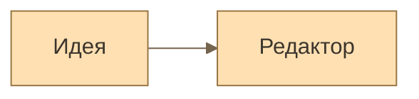

# Оформление отдельной диаграммы

В правом верхнем углу блока `mermaid`, рядом с разворачиванием, доступно меню оформления. Такое же меню находится в полноэкранном просмотрщике.

| Режим | Поведение |
|---|---|
| Авто | Следует теме документа. Явные цвета `classDef` и `style` работают как прежде. |
| Кастомная | Использует авторскую палитру из Markdown. Недоступна, если палитра не задана. |
| Светлая | Фиксирует светлую палитру этой диаграммы. |
| Тёмная | Фиксирует тёмную палитру этой диаграммы. |

Выбор в редактируемом документе — один шаг Undo. Авторские настройки сохраняются при переключении; «Авто» удаляет только служебный комментарий режима. В заблокированном документе и зеркале Split View выбор действует только для просмотра: файл не меняется. Разблокировка возвращает оформление из Markdown. HTML-экспорт учитывает текущее оформление.

Комментарий `%% mark:appearance custom %%` хранится внутри Markdown-блока, после YAML-заголовка. Другие Mermaid-движки воспринимают его как комментарий. Саму авторскую палитру они могут читать обычным способом.

Поддерживаются общие цвета `background`, `primaryColor` / `mainBkg` / `actorBkg`, `primaryTextColor` / `textColor` / `actorTextColor` / `nodeTextColor` / `classText`, `primaryBorderColor` / `nodeBorder` / `actorBorder` / `clusterBorder`, `secondaryColor` / `clusterBkg` / `altBackground`, `lineColor` / `signalColor` / `defaultLinkColor`, `labelTextColor`, `tertiaryColor`, а также серии `pie1…8`, `cScale0…7`, `git0…7`. При нескольких синонимах приоритет задаёт общая политика; `mainBkg` и `nodeBorder` имеют приоритет над `primaryColor` и `primaryBorderColor`. Цвета — буквальные HEX-значения. Поддерживается и прежний заголовок `%%{init: …}%%`; YAML `config` имеет приоритет над ним.

Это совместимость по цветам. Она не воспроизводит геометрию Mermaid, все его типовые настройки и шрифты. В светлом и тёмном режимах явные цветовые переопределения снимаются с отображаемого SVG, а толщина линий и прочее оформление сохраняются. Исходный текст и авторская палитра остаются на месте.
