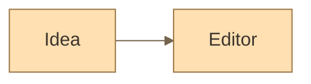

# Single diagram appearance

In the top-right corner of a `mermaid` block, next to the expand control, an appearance menu is available. The same menu lives in the fullscreen viewer.

| Mode | Behavior |
|---|---|
| Auto | Follows the document theme. Explicit `classDef` and `style` colors keep working as before. |
| Custom | Uses the author palette from Markdown. Unavailable when no palette is defined. |
| Light | Pins the light palette for this diagram. |
| Dark | Pins the dark palette for this diagram. |

Changing it inside an editable document is a single Undo step. Author settings survive mode switching; "Auto" removes only the mode's service comment. In a locked document and in the Split View mirror the choice is view-only: the file is not modified. Unlocking restores the appearance defined in Markdown. HTML export respects the current appearance.

The `%% mark:appearance custom %%` comment is stored inside the Markdown block, after the YAML header. Other Mermaid engines treat it as a comment. The author palette itself they can read the usual way.

Supported common colors: `background`, `primaryColor` / `mainBkg` / `actorBkg`, `primaryTextColor` / `textColor` / `actorTextColor` / `nodeTextColor` / `classText`, `primaryBorderColor` / `nodeBorder` / `actorBorder` / `clusterBorder`, `secondaryColor` / `clusterBkg` / `altBackground`, `lineColor` / `signalColor` / `defaultLinkColor`, `labelTextColor`, `tertiaryColor`, plus the `pie1…8`, `cScale0…7`, `git0…7` series. When several synonyms are present, priority follows the common policy; `mainBkg` and `nodeBorder` take precedence over `primaryColor` and `primaryBorderColor`. Colors are literal HEX values. The legacy `%%{init: …}%%` header is also supported; YAML `config` takes precedence over it.

This is color compatibility only. It does not reproduce Mermaid's geometry, its full set of defaults, or its fonts. In light and dark modes explicit color overrides are stripped from the rendered SVG, while stroke widths and other styling remain. The source text and the author palette stay in place.
