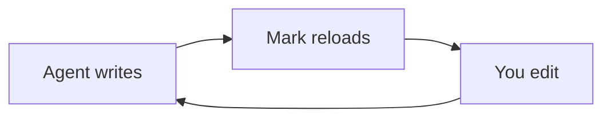

# Mark Guide

A short tour you can edit — this page is a normal Mark document. Nothing here is written to your files unless you choose Save As.

## Connect your agent

Give this to Claude Code, Codex, Cursor or any agent once. Paste it into its instructions file (for example `CLAUDE.md` or `AGENTS.md`) or straight into the chat. The copy button is on the block.

```text
@@AGENT_PROMPT@@
```

1. **It writes a file** — long plans and reports land in a `.md` file and open in Mark.
2. **Mark keeps up** — every save reloads the page and keeps your place.
3. **You shape it** — edit the finished page: fix steps, add notes, cut what's wrong.
4. **It reads you back** — the agent re-reads the file; your edits are its next instruction.

## Try it: tables

Tables are plain text, styled as you type. Add or remove rows from the toolbar when the cursor is inside.

| Feature | Shortcut |
| --- | --- |
| Split View | ⌘/Ctrl+Alt+\ |
| Diff | ⌘/Ctrl+D |

## Try it: callouts

A callout makes a note stand out. Type `> [!TIP]` as the first line of a quote.

> [!TIP]
> Five flavors: NOTE, TIP, IMPORTANT, WARNING, CAUTION.

## Try it: a Mermaid diagram

Diagrams render as you edit them.



## Try it: math

A `$$` block renders with KaTeX.

$$
e^{i\pi} + 1 = 0
$$

## Try it: Split View

⌘/Ctrl+Alt+\ shows source and preview side by side. Press it again to close.

## Try it: Copy as structured text

Edit › Copy as Structured Text copies the document as clean text that keeps bullets, links and tables — ready to paste into any chat.

## Try it: Diff

⌘/Ctrl+D toggles diff view and shows what changed since the last save.

## Try it: zoom

⌘/Ctrl+= bigger, ⌘/Ctrl+- smaller, ⌘/Ctrl+0 back to 100%.

## Try it: the fullscreen viewer

⌘/Ctrl-click a diagram, or press ⤢ on a diagram or a table, to open it fullscreen — zoom inside, Esc closes.
