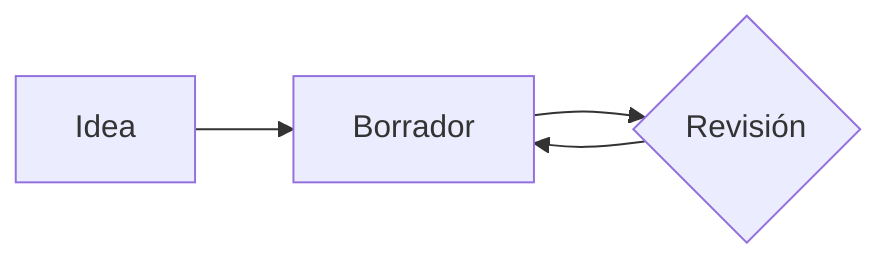
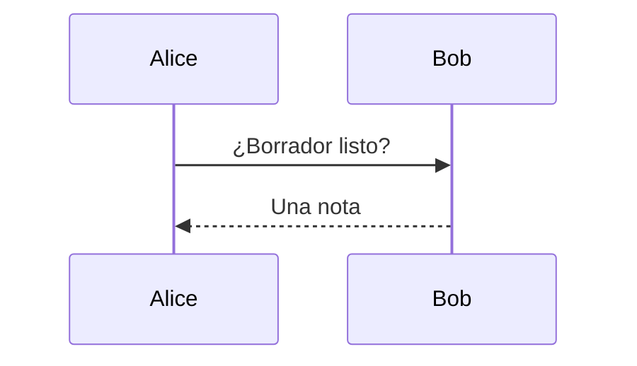
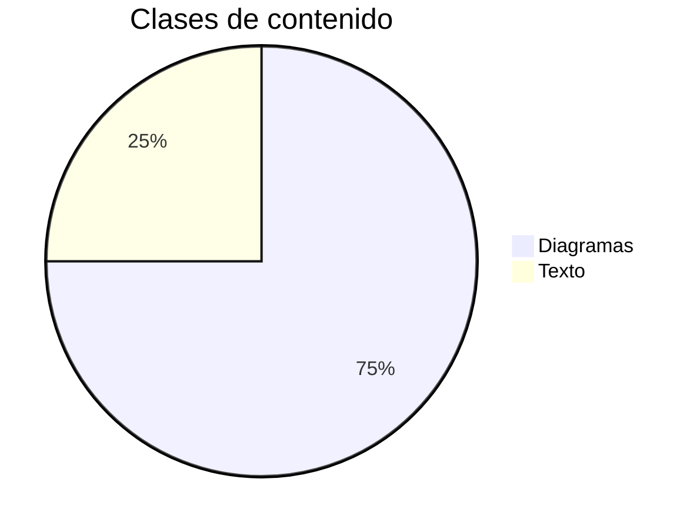
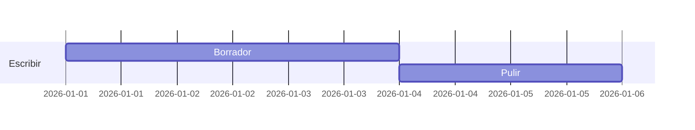
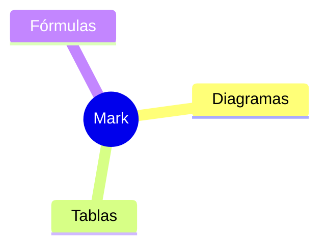
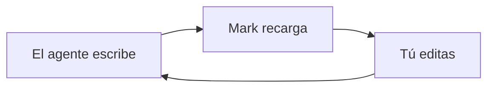

# Guía de Mark

Un recorrido breve que puedes editar: esta página es un documento normal de Mark. Nada de esto se escribe en tus archivos salvo que elijas Guardar como.

## Conecta tu agente

Dale esto a Claude Code, Codex, Cursor o cualquier agente, una sola vez. Pégalo en su archivo de instrucciones (por ejemplo `CLAUDE.md` o `AGENTS.md`) o directamente en el chat. El botón de copiar está en el bloque.

````text
@@AGENT_PROMPT@@
````

1. **Él escribe un archivo** — los planes e informes largos van a un archivo `.md` y se abren en Mark.
2. **Mark sigue el ritmo** — cada guardado recarga la página y conserva tu lugar.
3. **Tú le das forma** — edita la página terminada: corrige pasos, añade notas, corta lo que esté mal.
4. **Él te lee de vuelta** — el agente relee el archivo; tus ediciones son su siguiente instrucción.

## Qué renderiza Mark

Todo lo que tu agente puede poner en un documento, renderizado en vivo. Primero los diagramas:











Gráficos a partir de datos y los bloques rápidos:

```vega-lite
{"data":{"values":[{"kind":"A","count":3},{"kind":"B","count":5}]},"mark":"bar","encoding":{"x":{"field":"kind","type":"nominal"},"y":{"field":"count","type":"quantitative"}}}
```

```flowchart
st=>start: Inicio
op=>operation: Escribir
e=>end: Listo
st->op->e
```

```sequence
Title: Comprobación rápida
A->B: ¿Ping?
B-->A: Pong
```

Avisos — uno con título y otro plegable:

> [!NOTE] Dónde va el título
> Un título tras la etiqueta; el resto de la cita es el cuerpo.

> [!TIP]- Plegable
> Pulsa el título para plegar y desplegar esta nota.

Una checklist, matemáticas en ambas formas, una nota al pie y un emoji:

- [x] Escribir el borrador
- [ ] Revisarlo

Matemáticas en línea $a^2 + b^2 = c^2$ y un bloque:

$$
\int_0^1 x^2\,dx = \tfrac13
$$

Una nota al pie[^1] y un emoji :tada:.

[^1]: Las notas al pie guardan fuentes y apartes.

Y una tabla con alineación:

| Izquierda | Centro | Derecha |
| :--- | :----: | ----: |
| idea | notas | listo |
| plan | pasos | enviado |

## Pruébalo: tablas

Las tablas son texto plano con estilo mientras escribes. Añade o quita filas desde la barra cuando el cursor está dentro.

| Función | Atajo |
| --- | --- |
| Vista dividida | ⌘/Ctrl+Alt+\ |
| Diff | ⌘/Ctrl+D |

## Pruébalo: avisos

Un aviso hace destacar una nota. Escribe `> [!TIP]` en la primera línea de una cita.

> [!TIP]
> Cinco sabores: NOTE, TIP, IMPORTANT, WARNING, CAUTION.

## Pruébalo: un diagrama de Mermaid

Los diagramas se renderizan mientras los editas.



## Pruébalo: matemáticas

Un bloque `$$` se renderiza con KaTeX.

$$
e^{i\pi} + 1 = 0
$$

## Pruébalo: vista dividida

⌘/Ctrl+Alt+\ muestra fuente y vista previa lado a lado. Púlsalo otra vez para cerrarla.

## Pruébalo: copiar como texto estructurado

Editar › Copiar como texto estructurado copia el documento como texto limpio que conserva listas, enlaces y tablas; listo para pegar en cualquier chat.

## Pruébalo: diff

⌘/Ctrl+D alterna la vista de diferencias y muestra qué cambió desde el último guardado.

## Pruébalo: zoom

⌘/Ctrl+= más grande, ⌘/Ctrl+- más pequeño, ⌘/Ctrl+0 de vuelta al 100 %.

## Pruébalo: el visor a pantalla completa

⌘/Ctrl-clic en un diagrama, o ⤢ en un diagrama o una tabla, lo abre a pantalla completa; haz zoom dentro, Esc cierra.
