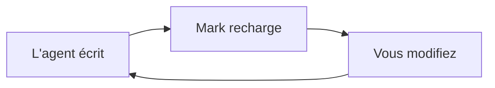

# Guide Mark

Une courte visite que vous pouvez modifier — cette page est un document Mark ordinaire. Rien n'est écrit dans vos fichiers, sauf si vous choisissez Enregistrer sous.

## Connectez votre agent

Donnez ceci à Claude Code, Codex, Cursor ou n'importe quel agent, une seule fois. Collez-le dans son fichier d'instructions (par exemple `CLAUDE.md` ou `AGENTS.md`) ou directement dans la conversation. Le bouton copier est sur le bloc.

```text
@@AGENT_PROMPT@@
```

1. **Il écrit un fichier** — les longs plans et rapports atterrissent dans un fichier `.md` et s'ouvrent dans Mark.
2. **Mark suit le rythme** — chaque enregistrement recharge la page et garde votre place.
3. **Vous le façonnez** — modifiez la page finie : corrigez les étapes, ajoutez des notes, coupez ce qui cloche.
4. **Il vous relit** — l'agent relit le fichier ; vos modifications sont sa prochaine instruction.

## Essayez : les tableaux

Les tableaux sont du texte simple, mis en forme pendant que vous tapez. Ajoutez ou supprimez des lignes depuis la barre quand le curseur est dedans.

| Fonction | Raccourci |
| --- | --- |
| Vue scindée | ⌘/Ctrl+Alt+\ |
| Diff | ⌘/Ctrl+D |

## Essayez : les encadrés

Un encadré fait ressortir une note. Tapez `> [!TIP]` en première ligne d'une citation.

> [!TIP]
> Cinq saveurs : NOTE, TIP, IMPORTANT, WARNING, CAUTION.

## Essayez : un diagramme Mermaid

Les diagrammes se dessinent pendant que vous les modifiez.



## Essayez : les maths

Un bloc `$$` est rendu par KaTeX.

$$
e^{i\pi} + 1 = 0
$$

## Essayez : la vue scindée

⌘/Ctrl+Alt+\ affiche la source et l'aperçu côte à côte. Réappuyez pour la fermer.

## Essayez : copier en texte structuré

Édition › Copier en texte structuré copie le document en texte propre qui garde puces, liens et tableaux — prêt à coller dans n'importe quelle conversation.

## Essayez : le diff

⌘/Ctrl+D bascule la vue des différences et montre ce qui a changé depuis le dernier enregistrement.

## Essayez : le zoom

⌘/Ctrl+= plus grand, ⌘/Ctrl+- plus petit, ⌘/Ctrl+0 retour à 100 %.

## Essayez : la visionneuse plein écran

⌘/Ctrl-clic sur un diagramme, ou ⤢ sur un diagramme ou un tableau, l'ouvre en plein écran — zoomez dedans, Échap ferme.
