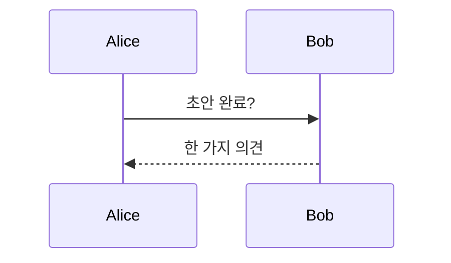
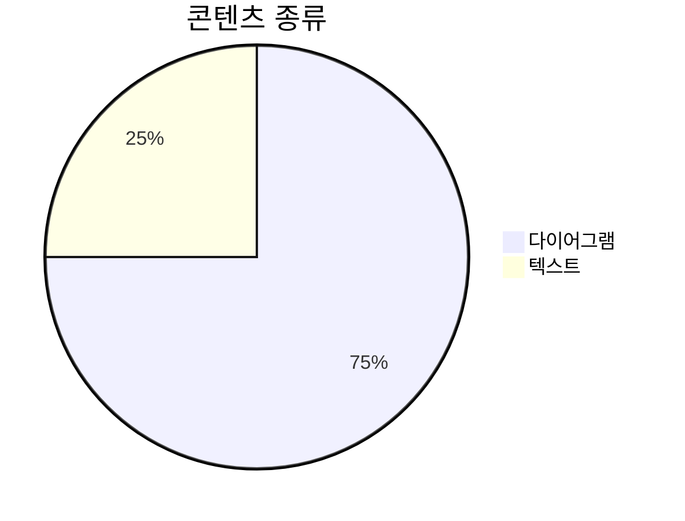
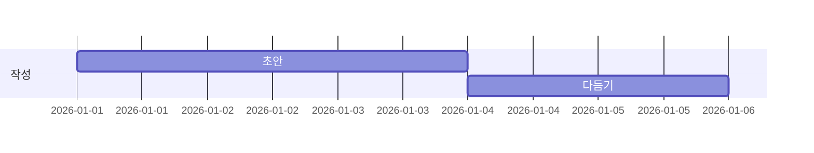
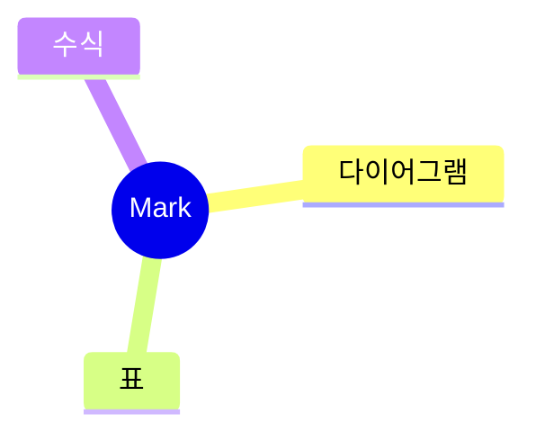

# Mark 가이드

직접 편집할 수 있는 짧은 둘러보기입니다. 이 페이지는 평범한 Mark 문서입니다. 다른 이름으로 저장을 선택하지 않는 한 파일에 기록되지 않습니다.

## 에이전트 연결

이 프롬프트를 Claude Code, Codex, Cursor 등 어떤 에이전트에든 한 번만 건네주세요. 지시 파일(예: `CLAUDE.md` 또는 `AGENTS.md`)이나 대화창에 바로 붙여넣으세요. 복사 버튼은 블록에 있습니다.

````text
@@AGENT_PROMPT@@
````

1. **에이전트가 파일을 씁니다** — 긴 계획과 보고서는 `.md` 파일로 남고 Mark에서 열립니다.
2. **Mark가 따라옵니다** — 저장할 때마다 페이지가 다시 로드되고 위치는 유지됩니다.
3. **당신이 다듬습니다** — 완성된 페이지를 편집하세요. 단계를 고치고, 메모를 더하고, 틀린 부분은 지웁니다.
4. **에이전트가 다시 읽습니다** — 에이전트는 파일을 다시 읽고, 당신의 편집이 다음 지시가 됩니다.

## Mark가 렌더링하는 것

에이전트가 문서에 넣을 수 있는 모든 것이 실시간으로 렌더링됩니다. 먼저 다이어그램:










데이터로 만드는 차트와 간단한 블록:

```vega-lite
{"data":{"values":[{"kind":"A","count":3},{"kind":"B","count":5}]},"mark":"bar","encoding":{"x":{"field":"kind","type":"nominal"},"y":{"field":"count","type":"quantitative"}}}
```

```flowchart
st=>start: 시작
op=>operation: 쓰기
e=>end: 완료
st->op->e
```

```sequence
Title: 빠른 확인
A->B: Ping?
B-->A: Pong
```

콜아웃 — 제목 있는 것과 접히는 것:

> [!NOTE] 제목이 오는 곳
> 태그 뒤에 제목을 붙이고, 인용의 나머지가 본문이 됩니다.

> [!TIP]- 접히는 콜아웃
> 제목을 클릭하면 이 메모를 접고 펼칠 수 있습니다.

체크리스트, 두 가지 형태의 수식, 각주, 이모지:

- [x] 초안 쓰기
- [ ] 검토하기

인라인 수식 $a^2 + b^2 = c^2$과 블록:

$$
\int_0^1 x^2\,dx = \tfrac13
$$

각주[^1]와 이모지 :tada:.

[^1]: 각주는 출처와 부가 설명을 담습니다.

그리고 열 정렬된 표:

| 왼쪽 | 가운데 | 오른쪽 |
| :--- | :----: | ----: |
| 아이디어 | 메모 | 완료 |
| 계획 | 단계 | 출시 |

## 직접 해보기: 표

표는 일반 텍스트이며 입력하는 대로 꾸며집니다. 커서를 안에 두면 도구 모음에서 행을 추가하거나 지울 수 있습니다.

| 기능 | 단축키 |
| --- | --- |
| 분할 보기 | ⌘/Ctrl+Alt+\ |
| 차이 보기 | ⌘/Ctrl+D |

## 직접 해보기: 콜아웃

콜아웃은 메모를 돋보이게 합니다. 인용 첫 줄에 `> [!TIP]`를 입력하세요.

> [!TIP]
> 다섯 가지: NOTE, TIP, IMPORTANT, WARNING, CAUTION.

## 직접 해보기: Mermaid 다이어그램

다이어그램은 편집하는 대로 렌더링됩니다.


## 직접 해보기: 수식

`$$` 블록은 KaTeX로 렌더링됩니다.

$$
e^{i\pi} + 1 = 0
$$

## 직접 해보기: 분할 보기

⌘/Ctrl+Alt+\ 로 원본과 미리보기를 나란히 봅니다. 다시 누르면 닫힙니다.

## 직접 해보기: 구조화 텍스트로 복사

편집 › 구조화 텍스트로 복사 는 목록, 링크, 표를 유지한 깔끔한 텍스트로 문서를 복사합니다. 어느 대화창에든 바로 붙여넣을 수 있습니다.

## 직접 해보기: 차이 보기

⌘/Ctrl+D 로 차이 보기를 켜고 끄며, 마지막 저장 이후의 변경 사항을 봅니다.

## 직접 해보기: 확대/축소

⌘/Ctrl+= 크게, ⌘/Ctrl+- 작게, ⌘/Ctrl+0 100%로 복원.

## 직접 해보기: 전체 화면 뷰어

다이어그램을 ⌘/Ctrl+클릭하거나 다이어그램이나 표의 ⤢ 를 누르면 전체 화면으로 열립니다. 안에서 확대하고 Esc로 닫습니다.
