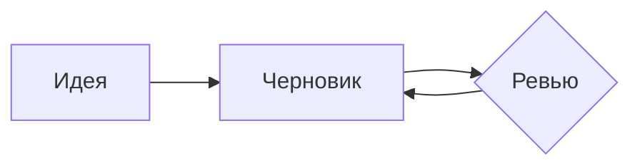
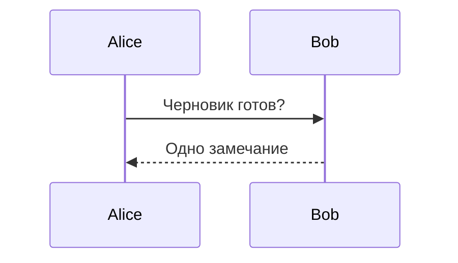
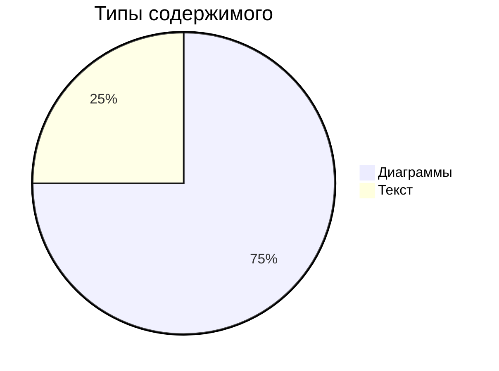
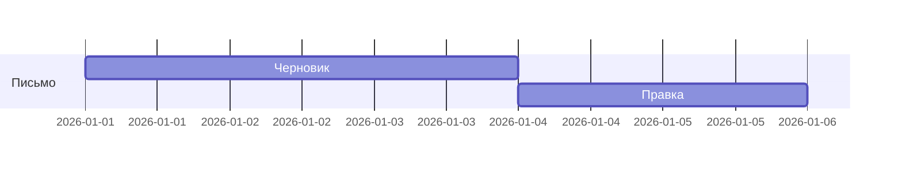
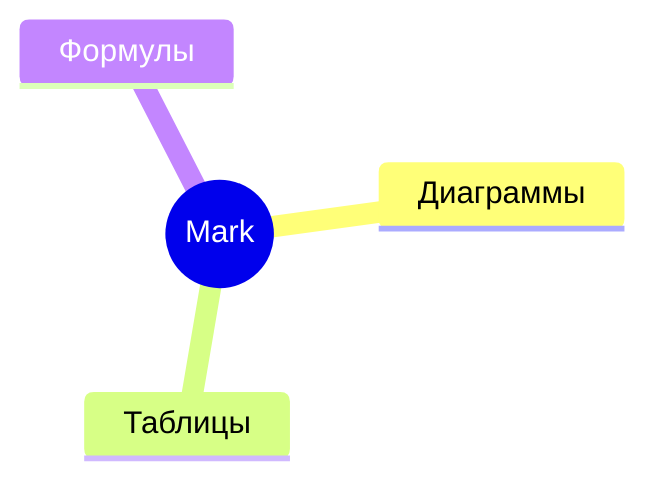
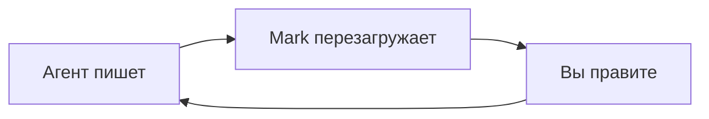

# Гид по Mark

Короткий тур, который можно редактировать — это обычный документ Mark. Ничего не записывается в ваши файлы, пока вы не выберете «Сохранить как».

## Подключите агента

Дайте это Claude Code, Codex, Cursor или любому другому агенту один раз. Вставьте в его файл инструкций (например, `CLAUDE.md` или `AGENTS.md`) или прямо в чат. Кнопка копирования — на самом блоке.

````text
@@AGENT_PROMPT@@
````

1. **Он пишет файл** — длинные планы и отчёты попадают в файл `.md` и открываются в Mark.
2. **Mark успевает** — при каждом сохранении страница перезагружается и держит ваше место.
3. **Вы правите страницу** — редактируйте готовое: исправьте шаги, добавьте заметки, уберите лишнее.
4. **Он читает вас** — агент перечитывает файл; ваши правки — его следующая инструкция.

## Что рисует Mark

Всё, что агент может положить в документ, отображается сразу. Сначала диаграммы:











Графики из данных и быстрые блоки:

```vega-lite
{"data":{"values":[{"kind":"A","count":3},{"kind":"B","count":5}]},"mark":"bar","encoding":{"x":{"field":"kind","type":"nominal"},"y":{"field":"count","type":"quantitative"}}}
```

```flowchart
st=>start: Старт
op=>operation: Пишем
e=>end: Готово
st->op->e
```

```sequence
Title: Быстрая проверка
A->B: Пинг?
B-->A: Понг
```

Выноски — с заголовком и сворачиваемая:

> [!NOTE] Где место заголовка
> Заголовок идёт после тега; остальная часть цитаты — текст.

> [!TIP]- Сворачиваемая
> Щёлкните по заголовку, чтобы свернуть или развернуть заметку.

Чек-лист, формулы в двух видах, сноска и эмодзи:

- [x] Написать черновик
- [ ] Проверить его

Формула в строке $a^2 + b^2 = c^2$ и блок:

$$
\int_0^1 x^2\,dx = \tfrac13
$$

Сноска[^1] и эмодзи :tada:.

[^1]: Сноски держат источники и замечания.

И таблица с выравниванием:

| Слева | Центр | Справа |
| :--- | :----: | ----: |
| идея | заметки | готово |
| план | шаги | запуск |

## Попробуйте: таблицы

Таблицы — обычный текст, оформленный на лету. Строки добавляйте и удаляйте из панели, когда курсор внутри.

| Возможность | Горячая клавиша |
| --- | --- |
| Разделённый вид | ⌘/Ctrl+Alt+\ |
| Diff | ⌘/Ctrl+D |

## Попробуйте: калауты

Калаут выделяет заметку. Наберите `> [!TIP]` в первой строке цитаты.

> [!TIP]
> Пять видов: NOTE, TIP, IMPORTANT, WARNING, CAUTION.

## Попробуйте: диаграмма Mermaid

Диаграммы рисуются прямо во время редактирования.



## Попробуйте: формулы

Блок `$$` рендерится через KaTeX.

$$
e^{i\pi} + 1 = 0
$$

## Попробуйте: разделённый вид

⌘/Ctrl+Alt+\ показывает исходник и предпросмотр рядом. Повторное нажатие закрывает.

## Попробуйте: копировать как структурированный текст

Правка › Копировать как структурированный текст копирует документ чистым текстом, сохраняя списки, ссылки и таблицы — готово для вставки в любой чат.

## Попробуйте: diff

⌘/Ctrl+D переключает показ изменений с последнего сохранения.

## Попробуйте: масштаб

⌘/Ctrl+= крупнее, ⌘/Ctrl+- мельче, ⌘/Ctrl+0 вернуть 100%.

## Попробуйте: полноэкранный просмотр

⌘/Ctrl-клик по диаграмме или кнопка ⤢ у диаграммы и таблицы открывает её на весь экран — масштаб внутри, Esc закрывает.
