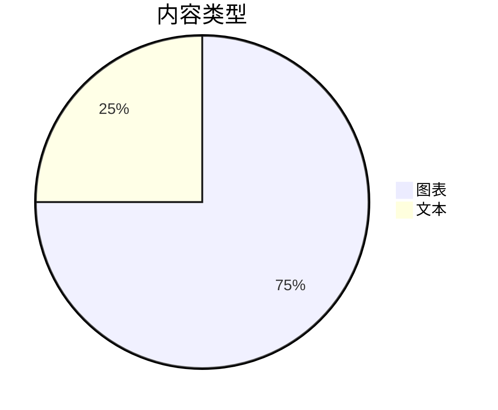

# Mark 指南

这是一份可以随手编辑的简短导览——本页面就是一个普通的 Mark 文档。除非你选择“另存为”，这里的内容不会写入你的文件。

## 连接你的智能体

把下面这段话交给 Claude Code、Codex、Cursor 或任何智能体，只需一次。粘贴到它的指令文件（例如 `CLAUDE.md` 或 `AGENTS.md`），或直接贴进对话。代码块自带复制按钮。

````text
@@AGENT_PROMPT@@
````

1. **它写文件** — 长计划和报告落进 `.md` 文件，并在 Mark 中打开。
2. **Mark 跟得上** — 每次保存都会刷新页面，并保持你的位置。
3. **你来塑造** — 在成稿上编辑：修正步骤、补充笔记、删掉错误。
4. **它读回你** — 智能体重新读取文件；你的编辑就是它的下一条指令。

## Mark 能渲染什么

智能体能写进文档的所有内容，都会实时渲染。先看图表：





数据图表与快速块：

```vega-lite
{"data":{"values":[{"kind":"A","count":3},{"kind":"B","count":5}]},"mark":"bar","encoding":{"x":{"field":"kind","type":"nominal"},"y":{"field":"count","type":"quantitative"}}}
```

```flowchart
st=>start: 开始
op=>operation: 撰写
e=>end: 完成
st->op->e
```

```sequence
Title: 快速确认
A->B: Ping?
B-->A: Pong
```

提示框——一个带标题，一个可折叠：

> [!NOTE] 标题放在哪里
> 标签后写标题；引用的其余部分是正文。

> [!TIP]- 可折叠
> 点击标题即可折叠和展开这条备注。

一份清单、两种形态的公式、脚注和表情符号：

- [x] 写完草稿
- [ ] 进行评审

行内公式 $a^2 + b^2 = c^2$ 和块级公式：

$$
\int_0^1 x^2\,dx = \tfrac13
$$

一个脚注[^1]和表情符号 :tada:。

[^1]: 脚注收纳出处和附注。

再来一张带对齐的表格：

| 左对齐 | 居中 | 右对齐 |
| :--- | :----: | ----: |
| 想法 | 备注 | 完成 |
| 计划 | 步骤 | 发布 |

## 试一试：表格

表格就是纯文本，输入时即时排版。光标位于其中时，可从工具栏增删行。

| 功能 | 快捷键 |
| --- | --- |
| 分屏视图 | ⌘/Ctrl+Alt+\ |
| 差异 | ⌘/Ctrl+D |

## 试一试：提示框

提示框让备注更醒目。在引用的第一行输入 `> [!TIP]`。

> [!TIP]
> 五种类型：NOTE、TIP、IMPORTANT、WARNING、CAUTION。

## 试一试：Mermaid 图

图表会边编辑边渲染。


## 试一试：数学公式

`$$` 块使用 KaTeX 渲染。

$$
e^{i\pi} + 1 = 0
$$

## 试一试：分屏视图

⌘/Ctrl+Alt+\ 让源码与预览并排显示。再按一次关闭。

## 试一试：复制为结构化文本

编辑 › 复制为结构化文本 会以干净的文本复制文档，同时保留列表、链接和表格——可直接粘贴到任何对话。

## 试一试：差异

⌘/Ctrl+D 切换差异视图，查看自上次保存以来的改动。

## 试一试：缩放

⌘/Ctrl+= 放大，⌘/Ctrl+- 缩小，⌘/Ctrl+0 恢复 100%。

## 试一试：全屏查看器

按住 ⌘/Ctrl 点击图表，或点击图表、表格上的 ⤢，即可全屏打开——内部可缩放，Esc 关闭。
