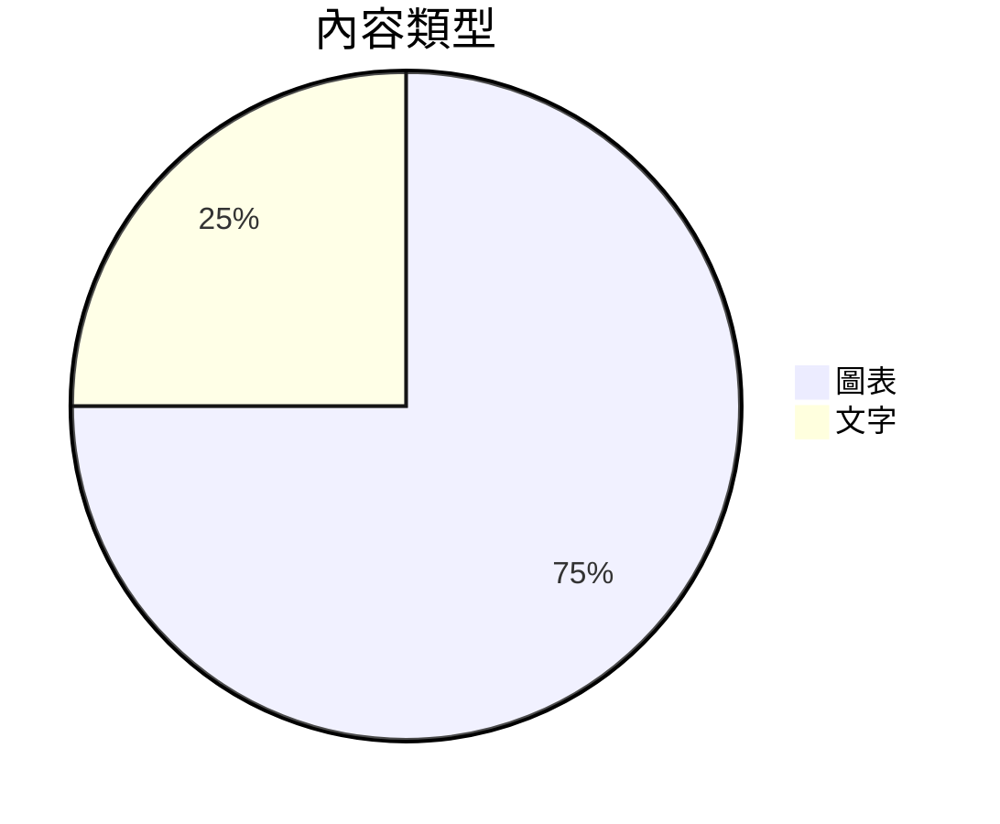

# Mark 指南

這是一份可以隨手編輯的簡短導覽——本頁面就是一個普通的 Mark 文件。除非你選擇「另存新檔」，這裡的內容不會寫入你的檔案。

## 連接你的 AI 代理

把下面這段話交給 Claude Code、Codex、Cursor 或任何 AI 代理，只需一次。貼到它的指示檔（例如 `CLAUDE.md` 或 `AGENTS.md`），或直接貼進對話。程式碼區塊附帶複製按鈕。

````text
@@AGENT_PROMPT@@
````

1. **它寫檔案** — 長計畫和報告落進 `.md` 檔案，並在 Mark 開啟。
2. **Mark 跟得上** — 每次儲存都會重新載入頁面，並保留你的位置。
3. **你來塑造** — 在成稿上編輯：修正步驟、補充筆記、刪掉錯誤。
4. **它讀回你** — 代理重新讀取檔案；你的編輯就是它的下一條指示。

## Mark 能呈現什麼

代理能寫進文件的所有內容，都會即時呈現。先看圖表：





資料圖表與快速區塊：

```vega-lite
{"data":{"values":[{"kind":"A","count":3},{"kind":"B","count":5}]},"mark":"bar","encoding":{"x":{"field":"kind","type":"nominal"},"y":{"field":"count","type":"quantitative"}}}
```

```flowchart
st=>start: 開始
op=>operation: 撰寫
e=>end: 完成
st->op->e
```

```sequence
Title: 快速確認
A->B: Ping?
B-->A: Pong
```

提示方塊——一個帶標題，一個可摺疊：

> [!NOTE] 標題放在哪裡
> 標籤後寫標題；引用的其餘部分是本文。

> [!TIP]- 可摺疊
> 點擊標題即可摺疊和展開這條備註。

一份清單、兩種形態的公式、註腳和表情符號：

- [x] 寫完草稿
- [ ] 進行審閱

行內公式 $a^2 + b^2 = c^2$ 與區塊公式：

$$
\int_0^1 x^2\,dx = \tfrac13
$$

一個註腳[^1]和表情符號 :tada:。

[^1]: 註腳收納出處與附註。

再來一張帶對齊的表格：

| 靠左 | 置中 | 靠右 |
| :--- | :----: | ----: |
| 想法 | 備註 | 完成 |
| 計畫 | 步驟 | 發佈 |

## 試一試：表格

表格就是純文字，輸入時即時排版。游標位於其中時，可從工具列增刪列。

| 功能 | 快速鍵 |
| --- | --- |
| 分割檢視 | ⌘/Ctrl+Alt+\ |
| 差異 | ⌘/Ctrl+D |

## 試一試：提示方塊

提示方塊讓備註更醒目。在引用的第一行輸入 `> [!TIP]`。

> [!TIP]
> 五種類型：NOTE、TIP、IMPORTANT、WARNING、CAUTION。

## 試一試：Mermaid 圖

圖表會邊編輯邊呈現。


## 試一試：數學公式

`$$` 區塊使用 KaTeX 呈現。

$$
e^{i\pi} + 1 = 0
$$

## 試一試：分割檢視

⌘/Ctrl+Alt+\ 讓原始碼與預覽並排顯示。再按一次關閉。

## 試一試：複製為結構化文字

編輯 › 複製為結構化文字 會以乾淨的文字複製文件，同時保留清單、連結和表格——可直接貼到任何對話。

## 試一試：差異

⌘/Ctrl+D 切換差異檢視，查看自上次儲存以來的變更。

## 試一試：縮放

⌘/Ctrl+= 放大，⌘/Ctrl+- 縮小，⌘/Ctrl+0 恢復 100%。

## 試一試：全螢幕檢視器

按住 ⌘/Ctrl 點擊圖表，或點擊圖表、表格上的 ⤢，即可全螢幕開啟——內部可縮放，Esc 關閉。
