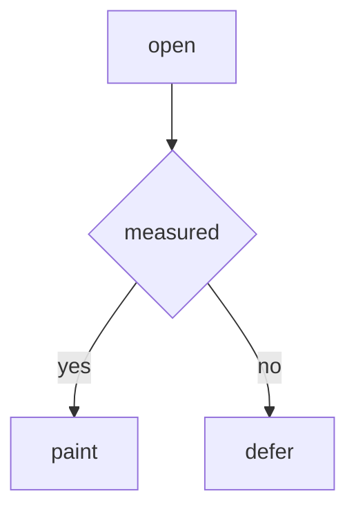
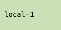

# Expensive leaves

## Math block 0

$$
\int_{0}^{\infty} e^{-x^2} dx = \frac{1}{2}\Gamma\left(\frac{1}{2}\right)
$$




## Math block 1

$$
\int_{0}^{\infty} e^{-x^3} dx = \frac{1}{3}\Gamma\left(\frac{1}{3}\right)
$$




## Math block 2

$$
\int_{0}^{\infty} e^{-x^4} dx = \frac{1}{4}\Gamma\left(\frac{1}{4}\right)
$$


## Math block 3

$$
\int_{0}^{\infty} e^{-x^5} dx = \frac{1}{5}\Gamma\left(\frac{1}{5}\right)
$$


## Math block 4

$$
\int_{0}^{\infty} e^{-x^6} dx = \frac{1}{6}\Gamma\left(\frac{1}{6}\right)
$$


## Math block 5

$$
\int_{0}^{\infty} e^{-x^2} dx = \frac{1}{2}\Gamma\left(\frac{1}{2}\right)
$$


## Math block 6

$$
\int_{0}^{\infty} e^{-x^3} dx = \frac{1}{3}\Gamma\left(\frac{1}{3}\right)
$$


## Math block 7

$$
\int_{0}^{\infty} e^{-x^4} dx = \frac{1}{4}\Gamma\left(\frac{1}{4}\right)
$$


## Math block 8

$$
\int_{0}^{\infty} e^{-x^5} dx = \frac{1}{5}\Gamma\left(\frac{1}{5}\right)
$$


## Math block 9

$$
\int_{0}^{\infty} e^{-x^6} dx = \frac{1}{6}\Gamma\left(\frac{1}{6}\right)
$$


## Math block 10

$$
\int_{0}^{\infty} e^{-x^2} dx = \frac{1}{2}\Gamma\left(\frac{1}{2}\right)
$$


## Math block 11

$$
\int_{0}^{\infty} e^{-x^3} dx = \frac{1}{3}\Gamma\left(\frac{1}{3}\right)
$$


## Math block 12

$$
\int_{0}^{\infty} e^{-x^4} dx = \frac{1}{4}\Gamma\left(\frac{1}{4}\right)
$$


## Math block 13

$$
\int_{0}^{\infty} e^{-x^5} dx = \frac{1}{5}\Gamma\left(\frac{1}{5}\right)
$$


## Math block 14

$$
\int_{0}^{\infty} e^{-x^6} dx = \frac{1}{6}\Gamma\left(\frac{1}{6}\right)
$$


## Math block 15

$$
\int_{0}^{\infty} e^{-x^2} dx = \frac{1}{2}\Gamma\left(\frac{1}{2}\right)
$$


## Math block 16

$$
\int_{0}^{\infty} e^{-x^3} dx = \frac{1}{3}\Gamma\left(\frac{1}{3}\right)
$$


## Math block 17

$$
\int_{0}^{\infty} e^{-x^4} dx = \frac{1}{4}\Gamma\left(\frac{1}{4}\right)
$$


## Math block 18

$$
\int_{0}^{\infty} e^{-x^5} dx = \frac{1}{5}\Gamma\left(\frac{1}{5}\right)
$$


## Math block 19

$$
\int_{0}^{\infty} e^{-x^6} dx = \frac{1}{6}\Gamma\left(\frac{1}{6}\right)
$$


## Math block 20

$$
\int_{0}^{\infty} e^{-x^2} dx = \frac{1}{2}\Gamma\left(\frac{1}{2}\right)
$$


```mermaid
graph TD
  A[open] --> B{measured}
  B -->|yes| C[paint]
  B -->|no| D[defer]
```

## Math block 21

$$
\int_{0}^{\infty} e^{-x^3} dx = \frac{1}{3}\Gamma\left(\frac{1}{3}\right)
$$


```mermaid
graph TD
  A[open] --> B{measured}
  B -->|yes| C[paint]
  B -->|no| D[defer]
```

## Math block 22

$$
\int_{0}^{\infty} e^{-x^4} dx = \frac{1}{4}\Gamma\left(\frac{1}{4}\right)
$$


```mermaid
graph TD
  A[open] --> B{measured}
  B -->|yes| C[paint]
  B -->|no| D[defer]
```

## Math block 23

$$
\int_{0}^{\infty} e^{-x^5} dx = \frac{1}{5}\Gamma\left(\frac{1}{5}\right)
$$


```mermaid
graph TD
  A[open] --> B{measured}
  B -->|yes| C[paint]
  B -->|no| D[defer]
```

## Math block 24

$$
\int_{0}^{\infty} e^{-x^6} dx = \frac{1}{6}\Gamma\left(\frac{1}{6}\right)
$$


```mermaid
graph TD
  A[open] --> B{measured}
  B -->|yes| C[paint]
  B -->|no| D[defer]
```

## Math block 25

$$
\int_{0}^{\infty} e^{-x^2} dx = \frac{1}{2}\Gamma\left(\frac{1}{2}\right)
$$


```mermaid
graph TD
  A[open] --> B{measured}
  B -->|yes| C[paint]
  B -->|no| D[defer]
```

## Math block 26

$$
\int_{0}^{\infty} e^{-x^3} dx = \frac{1}{3}\Gamma\left(\frac{1}{3}\right)
$$


```mermaid
graph TD
  A[open] --> B{measured}
  B -->|yes| C[paint]
  B -->|no| D[defer]
```

## Math block 27

$$
\int_{0}^{\infty} e^{-x^4} dx = \frac{1}{4}\Gamma\left(\frac{1}{4}\right)
$$


```mermaid
graph TD
  A[open] --> B{measured}
  B -->|yes| C[paint]
  B -->|no| D[defer]
```

## Math block 28

$$
\int_{0}^{\infty} e^{-x^5} dx = \frac{1}{5}\Gamma\left(\frac{1}{5}\right)
$$


```mermaid
graph TD
  A[open] --> B{measured}
  B -->|yes| C[paint]
  B -->|no| D[defer]
```

## Math block 29

$$
\int_{0}^{\infty} e^{-x^6} dx = \frac{1}{6}\Gamma\left(\frac{1}{6}\right)
$$


```mermaid
graph TD
  A[open] --> B{measured}
  B -->|yes| C[paint]
  B -->|no| D[defer]
```

## Math block 30

$$
\int_{0}^{\infty} e^{-x^2} dx = \frac{1}{2}\Gamma\left(\frac{1}{2}\right)
$$


```mermaid
graph TD
  A[open] --> B{measured}
  B -->|yes| C[paint]
  B -->|no| D[defer]
```

## Math block 31

$$
\int_{0}^{\infty} e^{-x^3} dx = \frac{1}{3}\Gamma\left(\frac{1}{3}\right)
$$


```mermaid
graph TD
  A[open] --> B{measured}
  B -->|yes| C[paint]
  B -->|no| D[defer]
```

## Math block 32

$$
\int_{0}^{\infty} e^{-x^4} dx = \frac{1}{4}\Gamma\left(\frac{1}{4}\right)
$$


```mermaid
graph TD
  A[open] --> B{measured}
  B -->|yes| C[paint]
  B -->|no| D[defer]
```

## Math block 33

$$
\int_{0}^{\infty} e^{-x^5} dx = \frac{1}{5}\Gamma\left(\frac{1}{5}\right)
$$


```mermaid
graph TD
  A[open] --> B{measured}
  B -->|yes| C[paint]
  B -->|no| D[defer]
```

## Math block 34

$$
\int_{0}^{\infty} e^{-x^6} dx = \frac{1}{6}\Gamma\left(\frac{1}{6}\right)
$$


```mermaid
graph TD
  A[open] --> B{measured}
  B -->|yes| C[paint]
  B -->|no| D[defer]
```

## Math block 35

$$
\int_{0}^{\infty} e^{-x^2} dx = \frac{1}{2}\Gamma\left(\frac{1}{2}\right)
$$


```mermaid
graph TD
  A[open] --> B{measured}
  B -->|yes| C[paint]
  B -->|no| D[defer]
```

## Math block 36

$$
\int_{0}^{\infty} e^{-x^3} dx = \frac{1}{3}\Gamma\left(\frac{1}{3}\right)
$$


```mermaid
graph TD
  A[open] --> B{measured}
  B -->|yes| C[paint]
  B -->|no| D[defer]
```

## Math block 37

$$
\int_{0}^{\infty} e^{-x^4} dx = \frac{1}{4}\Gamma\left(\frac{1}{4}\right)
$$


```mermaid
graph TD
  A[open] --> B{measured}
  B -->|yes| C[paint]
  B -->|no| D[defer]
```

## Math block 38

$$
\int_{0}^{\infty} e^{-x^5} dx = \frac{1}{5}\Gamma\left(\frac{1}{5}\right)
$$


```mermaid
graph TD
  A[open] --> B{measured}
  B -->|yes| C[paint]
  B -->|no| D[defer]
```

## Math block 39

$$
\int_{0}^{\infty} e^{-x^6} dx = \frac{1}{6}\Gamma\left(\frac{1}{6}\right)
$$


```mermaid
graph TD
  A[open] --> B{measured}
  B -->|yes| C[paint]
  B -->|no| D[defer]
```

## Math block 40

$$
\int_{0}^{\infty} e^{-x^2} dx = \frac{1}{2}\Gamma\left(\frac{1}{2}\right)
$$


```mermaid
graph TD
  A[open] --> B{measured}
  B -->|yes| C[paint]
  B -->|no| D[defer]
```

## Math block 41

$$
\int_{0}^{\infty} e^{-x^3} dx = \frac{1}{3}\Gamma\left(\frac{1}{3}\right)
$$


```mermaid
graph TD
  A[open] --> B{measured}
  B -->|yes| C[paint]
  B -->|no| D[defer]
```

## Math block 42

$$
\int_{0}^{\infty} e^{-x^4} dx = \frac{1}{4}\Gamma\left(\frac{1}{4}\right)
$$


```mermaid
graph TD
  A[open] --> B{measured}
  B -->|yes| C[paint]
  B -->|no| D[defer]
```

## Math block 43

$$
\int_{0}^{\infty} e^{-x^5} dx = \frac{1}{5}\Gamma\left(\frac{1}{5}\right)
$$


```mermaid
graph TD
  A[open] --> B{measured}
  B -->|yes| C[paint]
  B -->|no| D[defer]
```

## Math block 44

$$
\int_{0}^{\infty} e^{-x^6} dx = \frac{1}{6}\Gamma\left(\frac{1}{6}\right)
$$


```mermaid
graph TD
  A[open] --> B{measured}
  B -->|yes| C[paint]
  B -->|no| D[defer]
```

## Math block 45

$$
\int_{0}^{\infty} e^{-x^2} dx = \frac{1}{2}\Gamma\left(\frac{1}{2}\right)
$$


```mermaid
graph TD
  A[open] --> B{measured}
  B -->|yes| C[paint]
  B -->|no| D[defer]
```

## Math block 46

$$
\int_{0}^{\infty} e^{-x^3} dx = \frac{1}{3}\Gamma\left(\frac{1}{3}\right)
$$


```mermaid
graph TD
  A[open] --> B{measured}
  B -->|yes| C[paint]
  B -->|no| D[defer]
```

## Math block 47

$$
\int_{0}^{\infty} e^{-x^4} dx = \frac{1}{4}\Gamma\left(\frac{1}{4}\right)
$$


```mermaid
graph TD
  A[open] --> B{measured}
  B -->|yes| C[paint]
  B -->|no| D[defer]
```

## Math block 48

$$
\int_{0}^{\infty} e^{-x^5} dx = \frac{1}{5}\Gamma\left(\frac{1}{5}\right)
$$


```mermaid
graph TD
  A[open] --> B{measured}
  B -->|yes| C[paint]
  B -->|no| D[defer]
```

## Math block 49

$$
\int_{0}^{\infty} e^{-x^6} dx = \frac{1}{6}\Gamma\left(\frac{1}{6}\right)
$$


```mermaid
graph TD
  A[open] --> B{measured}
  B -->|yes| C[paint]
  B -->|no| D[defer]
```

## Math block 50

$$
\int_{0}^{\infty} e^{-x^2} dx = \frac{1}{2}\Gamma\left(\frac{1}{2}\right)
$$


```mermaid
graph TD
  A[open] --> B{measured}
  B -->|yes| C[paint]
  B -->|no| D[defer]
```

## Math block 51

$$
\int_{0}^{\infty} e^{-x^3} dx = \frac{1}{3}\Gamma\left(\frac{1}{3}\right)
$$


```mermaid
graph TD
  A[open] --> B{measured}
  B -->|yes| C[paint]
  B -->|no| D[defer]
```

## Math block 52

$$
\int_{0}^{\infty} e^{-x^4} dx = \frac{1}{4}\Gamma\left(\frac{1}{4}\right)
$$


```mermaid
graph TD
  A[open] --> B{measured}
  B -->|yes| C[paint]
  B -->|no| D[defer]
```

## Math block 53

$$
\int_{0}^{\infty} e^{-x^5} dx = \frac{1}{5}\Gamma\left(\frac{1}{5}\right)
$$


```mermaid
graph TD
  A[open] --> B{measured}
  B -->|yes| C[paint]
  B -->|no| D[defer]
```

## Math block 54

$$
\int_{0}^{\infty} e^{-x^6} dx = \frac{1}{6}\Gamma\left(\frac{1}{6}\right)
$$


```mermaid
graph TD
  A[open] --> B{measured}
  B -->|yes| C[paint]
  B -->|no| D[defer]
```

## Math block 55

$$
\int_{0}^{\infty} e^{-x^2} dx = \frac{1}{2}\Gamma\left(\frac{1}{2}\right)
$$


```mermaid
graph TD
  A[open] --> B{measured}
  B -->|yes| C[paint]
  B -->|no| D[defer]
```

## Math block 56

$$
\int_{0}^{\infty} e^{-x^3} dx = \frac{1}{3}\Gamma\left(\frac{1}{3}\right)
$$


```mermaid
graph TD
  A[open] --> B{measured}
  B -->|yes| C[paint]
  B -->|no| D[defer]
```

## Math block 57

$$
\int_{0}^{\infty} e^{-x^4} dx = \frac{1}{4}\Gamma\left(\frac{1}{4}\right)
$$


```mermaid
graph TD
  A[open] --> B{measured}
  B -->|yes| C[paint]
  B -->|no| D[defer]
```

## Math block 58

$$
\int_{0}^{\infty} e^{-x^5} dx = \frac{1}{5}\Gamma\left(\frac{1}{5}\right)
$$


```mermaid
graph TD
  A[open] --> B{measured}
  B -->|yes| C[paint]
  B -->|no| D[defer]
```

## Math block 59

$$
\int_{0}^{\infty} e^{-x^6} dx = \frac{1}{6}\Gamma\left(\frac{1}{6}\right)
$$


```mermaid
graph TD
  A[open] --> B{measured}
  B -->|yes| C[paint]
  B -->|no| D[defer]
```

## Math block 60

$$
\int_{0}^{\infty} e^{-x^2} dx = \frac{1}{2}\Gamma\left(\frac{1}{2}\right)
$$


```mermaid
graph TD
  A[open] --> B{measured}
  B -->|yes| C[paint]
  B -->|no| D[defer]
```

## Math block 61

$$
\int_{0}^{\infty} e^{-x^3} dx = \frac{1}{3}\Gamma\left(\frac{1}{3}\right)
$$


```mermaid
graph TD
  A[open] --> B{measured}
  B -->|yes| C[paint]
  B -->|no| D[defer]
```

## Math block 62

$$
\int_{0}^{\infty} e^{-x^4} dx = \frac{1}{4}\Gamma\left(\frac{1}{4}\right)
$$


```mermaid
graph TD
  A[open] --> B{measured}
  B -->|yes| C[paint]
  B -->|no| D[defer]
```

## Math block 63

$$
\int_{0}^{\infty} e^{-x^5} dx = \frac{1}{5}\Gamma\left(\frac{1}{5}\right)
$$


```mermaid
graph TD
  A[open] --> B{measured}
  B -->|yes| C[paint]
  B -->|no| D[defer]
```

## Math block 64

$$
\int_{0}^{\infty} e^{-x^6} dx = \frac{1}{6}\Gamma\left(\frac{1}{6}\right)
$$


```mermaid
graph TD
  A[open] --> B{measured}
  B -->|yes| C[paint]
  B -->|no| D[defer]
```

## Math block 65

$$
\int_{0}^{\infty} e^{-x^2} dx = \frac{1}{2}\Gamma\left(\frac{1}{2}\right)
$$


```mermaid
graph TD
  A[open] --> B{measured}
  B -->|yes| C[paint]
  B -->|no| D[defer]
```

## Math block 66

$$
\int_{0}^{\infty} e^{-x^3} dx = \frac{1}{3}\Gamma\left(\frac{1}{3}\right)
$$


```mermaid
graph TD
  A[open] --> B{measured}
  B -->|yes| C[paint]
  B -->|no| D[defer]
```

## Math block 67

$$
\int_{0}^{\infty} e^{-x^4} dx = \frac{1}{4}\Gamma\left(\frac{1}{4}\right)
$$


```mermaid
graph TD
  A[open] --> B{measured}
  B -->|yes| C[paint]
  B -->|no| D[defer]
```

## Math block 68

$$
\int_{0}^{\infty} e^{-x^5} dx = \frac{1}{5}\Gamma\left(\frac{1}{5}\right)
$$


```mermaid
graph TD
  A[open] --> B{measured}
  B -->|yes| C[paint]
  B -->|no| D[defer]
```

## Math block 69

$$
\int_{0}^{\infty} e^{-x^6} dx = \frac{1}{6}\Gamma\left(\frac{1}{6}\right)
$$


```mermaid
graph TD
  A[open] --> B{measured}
  B -->|yes| C[paint]
  B -->|no| D[defer]
```

## Math block 70

$$
\int_{0}^{\infty} e^{-x^2} dx = \frac{1}{2}\Gamma\left(\frac{1}{2}\right)
$$


```mermaid
graph TD
  A[open] --> B{measured}
  B -->|yes| C[paint]
  B -->|no| D[defer]
```

## Math block 71

$$
\int_{0}^{\infty} e^{-x^3} dx = \frac{1}{3}\Gamma\left(\frac{1}{3}\right)
$$


```mermaid
graph TD
  A[open] --> B{measured}
  B -->|yes| C[paint]
  B -->|no| D[defer]
```

## Math block 72

$$
\int_{0}^{\infty} e^{-x^4} dx = \frac{1}{4}\Gamma\left(\frac{1}{4}\right)
$$


```mermaid
graph TD
  A[open] --> B{measured}
  B -->|yes| C[paint]
  B -->|no| D[defer]
```

## Math block 73

$$
\int_{0}^{\infty} e^{-x^5} dx = \frac{1}{5}\Gamma\left(\frac{1}{5}\right)
$$


```mermaid
graph TD
  A[open] --> B{measured}
  B -->|yes| C[paint]
  B -->|no| D[defer]
```

## Math block 74

$$
\int_{0}^{\infty} e^{-x^6} dx = \frac{1}{6}\Gamma\left(\frac{1}{6}\right)
$$


```mermaid
graph TD
  A[open] --> B{measured}
  B -->|yes| C[paint]
  B -->|no| D[defer]
```

## Math block 75

$$
\int_{0}^{\infty} e^{-x^2} dx = \frac{1}{2}\Gamma\left(\frac{1}{2}\right)
$$


```mermaid
graph TD
  A[open] --> B{measured}
  B -->|yes| C[paint]
  B -->|no| D[defer]
```

## Math block 76

$$
\int_{0}^{\infty} e^{-x^3} dx = \frac{1}{3}\Gamma\left(\frac{1}{3}\right)
$$


```mermaid
graph TD
  A[open] --> B{measured}
  B -->|yes| C[paint]
  B -->|no| D[defer]
```

## Math block 77

$$
\int_{0}^{\infty} e^{-x^4} dx = \frac{1}{4}\Gamma\left(\frac{1}{4}\right)
$$


```mermaid
graph TD
  A[open] --> B{measured}
  B -->|yes| C[paint]
  B -->|no| D[defer]
```

## Math block 78

$$
\int_{0}^{\infty} e^{-x^5} dx = \frac{1}{5}\Gamma\left(\frac{1}{5}\right)
$$


```mermaid
graph TD
  A[open] --> B{measured}
  B -->|yes| C[paint]
  B -->|no| D[defer]
```

## Math block 79

$$
\int_{0}^{\infty} e^{-x^6} dx = \frac{1}{6}\Gamma\left(\frac{1}{6}\right)
$$


```mermaid
graph TD
  A[open] --> B{measured}
  B -->|yes| C[paint]
  B -->|no| D[defer]
```

## Math block 80

$$
\int_{0}^{\infty} e^{-x^2} dx = \frac{1}{2}\Gamma\left(\frac{1}{2}\right)
$$


```mermaid
graph TD
  A[open] --> B{measured}
  B -->|yes| C[paint]
  B -->|no| D[defer]
```

## Math block 81

$$
\int_{0}^{\infty} e^{-x^3} dx = \frac{1}{3}\Gamma\left(\frac{1}{3}\right)
$$


```mermaid
graph TD
  A[open] --> B{measured}
  B -->|yes| C[paint]
  B -->|no| D[defer]
```

## Math block 82

$$
\int_{0}^{\infty} e^{-x^4} dx = \frac{1}{4}\Gamma\left(\frac{1}{4}\right)
$$


```mermaid
graph TD
  A[open] --> B{measured}
  B -->|yes| C[paint]
  B -->|no| D[defer]
```

## Math block 83

$$
\int_{0}^{\infty} e^{-x^5} dx = \frac{1}{5}\Gamma\left(\frac{1}{5}\right)
$$


```mermaid
graph TD
  A[open] --> B{measured}
  B -->|yes| C[paint]
  B -->|no| D[defer]
```

## Math block 84

$$
\int_{0}^{\infty} e^{-x^6} dx = \frac{1}{6}\Gamma\left(\frac{1}{6}\right)
$$


```mermaid
graph TD
  A[open] --> B{measured}
  B -->|yes| C[paint]
  B -->|no| D[defer]
```

## Math block 85

$$
\int_{0}^{\infty} e^{-x^2} dx = \frac{1}{2}\Gamma\left(\frac{1}{2}\right)
$$


```mermaid
graph TD
  A[open] --> B{measured}
  B -->|yes| C[paint]
  B -->|no| D[defer]
```

## Math block 86

$$
\int_{0}^{\infty} e^{-x^3} dx = \frac{1}{3}\Gamma\left(\frac{1}{3}\right)
$$


```mermaid
graph TD
  A[open] --> B{measured}
  B -->|yes| C[paint]
  B -->|no| D[defer]
```

## Math block 87

$$
\int_{0}^{\infty} e^{-x^4} dx = \frac{1}{4}\Gamma\left(\frac{1}{4}\right)
$$


```mermaid
graph TD
  A[open] --> B{measured}
  B -->|yes| C[paint]
  B -->|no| D[defer]
```

## Math block 88

$$
\int_{0}^{\infty} e^{-x^5} dx = \frac{1}{5}\Gamma\left(\frac{1}{5}\right)
$$


```mermaid
graph TD
  A[open] --> B{measured}
  B -->|yes| C[paint]
  B -->|no| D[defer]
```

## Math block 89

$$
\int_{0}^{\infty} e^{-x^6} dx = \frac{1}{6}\Gamma\left(\frac{1}{6}\right)
$$


```mermaid
graph TD
  A[open] --> B{measured}
  B -->|yes| C[paint]
  B -->|no| D[defer]
```

## Math block 90

$$
\int_{0}^{\infty} e^{-x^2} dx = \frac{1}{2}\Gamma\left(\frac{1}{2}\right)
$$


```mermaid
graph TD
  A[open] --> B{measured}
  B -->|yes| C[paint]
  B -->|no| D[defer]
```

## Math block 91

$$
\int_{0}^{\infty} e^{-x^3} dx = \frac{1}{3}\Gamma\left(\frac{1}{3}\right)
$$


```mermaid
graph TD
  A[open] --> B{measured}
  B -->|yes| C[paint]
  B -->|no| D[defer]
```

## Math block 92

$$
\int_{0}^{\infty} e^{-x^4} dx = \frac{1}{4}\Gamma\left(\frac{1}{4}\right)
$$


```mermaid
graph TD
  A[open] --> B{measured}
  B -->|yes| C[paint]
  B -->|no| D[defer]
```

## Math block 93

$$
\int_{0}^{\infty} e^{-x^5} dx = \frac{1}{5}\Gamma\left(\frac{1}{5}\right)
$$


```mermaid
graph TD
  A[open] --> B{measured}
  B -->|yes| C[paint]
  B -->|no| D[defer]
```

## Math block 94

$$
\int_{0}^{\infty} e^{-x^6} dx = \frac{1}{6}\Gamma\left(\frac{1}{6}\right)
$$


```mermaid
graph TD
  A[open] --> B{measured}
  B -->|yes| C[paint]
  B -->|no| D[defer]
```

## Math block 95

$$
\int_{0}^{\infty} e^{-x^2} dx = \frac{1}{2}\Gamma\left(\frac{1}{2}\right)
$$


```mermaid
graph TD
  A[open] --> B{measured}
  B -->|yes| C[paint]
  B -->|no| D[defer]
```

## Math block 96

$$
\int_{0}^{\infty} e^{-x^3} dx = \frac{1}{3}\Gamma\left(\frac{1}{3}\right)
$$


```mermaid
graph TD
  A[open] --> B{measured}
  B -->|yes| C[paint]
  B -->|no| D[defer]
```

## Math block 97

$$
\int_{0}^{\infty} e^{-x^4} dx = \frac{1}{4}\Gamma\left(\frac{1}{4}\right)
$$


```mermaid
graph TD
  A[open] --> B{measured}
  B -->|yes| C[paint]
  B -->|no| D[defer]
```

## Math block 98

$$
\int_{0}^{\infty} e^{-x^5} dx = \frac{1}{5}\Gamma\left(\frac{1}{5}\right)
$$


```mermaid
graph TD
  A[open] --> B{measured}
  B -->|yes| C[paint]
  B -->|no| D[defer]
```

## Math block 99

$$
\int_{0}^{\infty} e^{-x^6} dx = \frac{1}{6}\Gamma\left(\frac{1}{6}\right)
$$


```mermaid
graph TD
  A[open] --> B{measured}
  B -->|yes| C[paint]
  B -->|no| D[defer]
```

## Math block 100

$$
\int_{0}^{\infty} e^{-x^2} dx = \frac{1}{2}\Gamma\left(\frac{1}{2}\right)
$$


```mermaid
graph TD
  A[open] --> B{measured}
  B -->|yes| C[paint]
  B -->|no| D[defer]
```

## Math block 101

$$
\int_{0}^{\infty} e^{-x^3} dx = \frac{1}{3}\Gamma\left(\frac{1}{3}\right)
$$


```mermaid
graph TD
  A[open] --> B{measured}
  B -->|yes| C[paint]
  B -->|no| D[defer]
```

## Math block 102

$$
\int_{0}^{\infty} e^{-x^4} dx = \frac{1}{4}\Gamma\left(\frac{1}{4}\right)
$$


```mermaid
graph TD
  A[open] --> B{measured}
  B -->|yes| C[paint]
  B -->|no| D[defer]
```

## Math block 103

$$
\int_{0}^{\infty} e^{-x^5} dx = \frac{1}{5}\Gamma\left(\frac{1}{5}\right)
$$


```mermaid
graph TD
  A[open] --> B{measured}
  B -->|yes| C[paint]
  B -->|no| D[defer]
```

## Math block 104

$$
\int_{0}^{\infty} e^{-x^6} dx = \frac{1}{6}\Gamma\left(\frac{1}{6}\right)
$$


```mermaid
graph TD
  A[open] --> B{measured}
  B -->|yes| C[paint]
  B -->|no| D[defer]
```

## Math block 105

$$
\int_{0}^{\infty} e^{-x^2} dx = \frac{1}{2}\Gamma\left(\frac{1}{2}\right)
$$


```mermaid
graph TD
  A[open] --> B{measured}
  B -->|yes| C[paint]
  B -->|no| D[defer]
```

## Math block 106

$$
\int_{0}^{\infty} e^{-x^3} dx = \frac{1}{3}\Gamma\left(\frac{1}{3}\right)
$$


```mermaid
graph TD
  A[open] --> B{measured}
  B -->|yes| C[paint]
  B -->|no| D[defer]
```

## Math block 107

$$
\int_{0}^{\infty} e^{-x^4} dx = \frac{1}{4}\Gamma\left(\frac{1}{4}\right)
$$


```mermaid
graph TD
  A[open] --> B{measured}
  B -->|yes| C[paint]
  B -->|no| D[defer]
```

## Math block 108

$$
\int_{0}^{\infty} e^{-x^5} dx = \frac{1}{5}\Gamma\left(\frac{1}{5}\right)
$$


```mermaid
graph TD
  A[open] --> B{measured}
  B -->|yes| C[paint]
  B -->|no| D[defer]
```

## Math block 109

$$
\int_{0}^{\infty} e^{-x^6} dx = \frac{1}{6}\Gamma\left(\frac{1}{6}\right)
$$


```mermaid
graph TD
  A[open] --> B{measured}
  B -->|yes| C[paint]
  B -->|no| D[defer]
```

## Math block 110

$$
\int_{0}^{\infty} e^{-x^2} dx = \frac{1}{2}\Gamma\left(\frac{1}{2}\right)
$$


```mermaid
graph TD
  A[open] --> B{measured}
  B -->|yes| C[paint]
  B -->|no| D[defer]
```

## Math block 111

$$
\int_{0}^{\infty} e^{-x^3} dx = \frac{1}{3}\Gamma\left(\frac{1}{3}\right)
$$


```mermaid
graph TD
  A[open] --> B{measured}
  B -->|yes| C[paint]
  B -->|no| D[defer]
```

## Math block 112

$$
\int_{0}^{\infty} e^{-x^4} dx = \frac{1}{4}\Gamma\left(\frac{1}{4}\right)
$$


```mermaid
graph TD
  A[open] --> B{measured}
  B -->|yes| C[paint]
  B -->|no| D[defer]
```

## Math block 113

$$
\int_{0}^{\infty} e^{-x^5} dx = \frac{1}{5}\Gamma\left(\frac{1}{5}\right)
$$


```mermaid
graph TD
  A[open] --> B{measured}
  B -->|yes| C[paint]
  B -->|no| D[defer]
```

## Math block 114

$$
\int_{0}^{\infty} e^{-x^6} dx = \frac{1}{6}\Gamma\left(\frac{1}{6}\right)
$$


```mermaid
graph TD
  A[open] --> B{measured}
  B -->|yes| C[paint]
  B -->|no| D[defer]
```

## Math block 115

$$
\int_{0}^{\infty} e^{-x^2} dx = \frac{1}{2}\Gamma\left(\frac{1}{2}\right)
$$


```mermaid
graph TD
  A[open] --> B{measured}
  B -->|yes| C[paint]
  B -->|no| D[defer]
```

## Math block 116

$$
\int_{0}^{\infty} e^{-x^3} dx = \frac{1}{3}\Gamma\left(\frac{1}{3}\right)
$$


```mermaid
graph TD
  A[open] --> B{measured}
  B -->|yes| C[paint]
  B -->|no| D[defer]
```

## Math block 117

$$
\int_{0}^{\infty} e^{-x^4} dx = \frac{1}{4}\Gamma\left(\frac{1}{4}\right)
$$


```mermaid
graph TD
  A[open] --> B{measured}
  B -->|yes| C[paint]
  B -->|no| D[defer]
```

## Math block 118

$$
\int_{0}^{\infty} e^{-x^5} dx = \frac{1}{5}\Gamma\left(\frac{1}{5}\right)
$$


```mermaid
graph TD
  A[open] --> B{measured}
  B -->|yes| C[paint]
  B -->|no| D[defer]
```

## Math block 119

$$
\int_{0}^{\infty} e^{-x^6} dx = \frac{1}{6}\Gamma\left(\frac{1}{6}\right)
$$


```mermaid
graph TD
  A[open] --> B{measured}
  B -->|yes| C[paint]
  B -->|no| D[defer]
```

